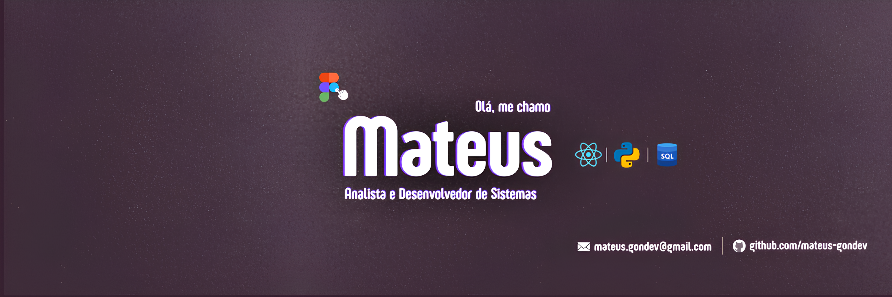

  

## 🚀 Sobre mim

Olá! Eu sou o **Mateus**, analista e desenvolvedor de sistemas, apaixonado por transformar ideias em soluções que funcionam bem e também são agradáveis de usar.

Gosto de unir a lógica do código com o olhar de **design e UX**: prototipo no Figma, construo interfaces com React e cuido dos dados com Python e SQL.

Tenho alguns projetos por aqui e estou sempre aprendendo algo novo. Fique à vontade para explorar meus repositórios!

## 🛠️ Stack

  

## 📌 Projetos em destaque

  
  

  
  

  

## 📊 Estatísticas do GitHub

  

  
  

## 📫 Contato

- ✉️ [mateus.gondev@gmail.com](mailto:mateus.gondev@gmail.com)
- 🐙 [github.com/mateus-gondev](https://github.com/mateus-gondev)
